# DoorCE Installation Prerequisites and Procedure

> ## ⚠️ IMPORTANT
> 
> #### A. Please follow these prerequisites and instructions precisely; e.g. installing additional packages to the operating system or creating different users can cause the installation process to break!
> #### B. Instructions for upgrading to a new version are provided in [UPGRADE.md](UPGRADE.md).


## Installation checklist

### Environment checklist

See Sections 1 and 2

- [ ] Target server - fulfilling minimum hardware requirements and with installed Debian
- [ ] GitHub repository - private repository with access granted to authorised persons
- [ ] Certificate - provided for the domain URL of the DoorCE service (cert + key)
- [ ] Network - access to the Internet for updates
- [ ] DNS - possibility to add an entry pointing to the appropriate IP address

### Installation checklist

See Sections 3 and 4

- [ ] Github configured
- [ ] Server configured
- [ ] DoorCEInstall repository access enabled
- [ ] Host setup completed
- [ ] Incus setup completed
- [ ] DoorCE setup completed
- [ ] Admin passwords configured

## 1. Target Server Requirements

### Architecture

- x86_64


### Hardware Requirements

- RAM: 16 GB 
- CPU Cores: 4
- Disk Space: 100 GB
    

### Operating System

- Linux Debian 13
- Ubuntu Server 24.04LTS (version 26.04 is not tested yet)

> 🛠️ **Note 1**:
>
> a minimal version of the operating system with SSH access and `sudo` with root privileges, installed for the user (recommended user: `debian`) who will be used for installation and management of DoorCE.
    
> ✨ **Note 2**:
>
> it is highly recommended to use a clean OS installation without additional software to avoid potential system conflicts.

## 2. Other Requirements

### Security

- **SSL/TLS Certificate:** A valid SSL/TLS certificate is required for the domain under which the DoorCE service will be available to ensure a secure HTTPS connection. You may use free certificates from Let's Encrypt or other certificate providers.
    
- **Firewall:** The DoorCE service installer defines firewall rules during the installation process to secure the server. It utilises `nftables`, a modern, efficient solution for managing firewall rules on Linux systems. The installer will configure rules allowing access to essential ports (SSH, HTTP, HTTPS). It is recommended that the server administrator has basic knowledge of `nftables` to verify that the firewall rules are correctly configured and do not block necessary network traffic after installation.

### Network

- Internet access for downloading updates and dependencies.
    
- Open port 22 for SSH (remote server management).
    
- Open ports 80 (HTTP – with automatic redirection to HTTPS) and 443 (HTTPS) for access to the DoorCE web interface and API.
    
> 🌐 **Note**:
> 
> The DoorCE installer will add several internal bridge networks for inter-container communication; this does not require additional network configuration from the user.

### DNS

- It is recommended to have a domain with correctly configured DNS records (A or CNAME) pointing to the IP address of the server where DoorCE will be installed. This enables secure HTTPS access, which is critical to system security.

### GitHub

- A GitHub account is required to manage the repository containing the configuration and GitHub Actions for the DoorCE service.
    
- A private GitHub repository is required to store configurations and scripts. This repository will be used to run GitHub Actions that automate service management tasks, including updates, status monitoring, and container management. It is recommended to enable two-factor authentication (2FA) for added security.

## 3. Installation Procedure

### Step 1 - GitHub Configuration

- Create a private repository on GitHub to manage the DoorCE service.
    
- Configure the repository by adding the necessary configuration files and scripts. To do this, use the repository template available in the [templates/github-repo](templates/github-repo) directory of the DoorCEInstall project. Copy the contents of that directory to your repository to establish the required file structure.

- In the `config.yaml` file, replace:
    - the hostname with the correct one (change from `doorce-vm3` _(1)_ to your actual server name)
    - `external_url` _(2)_ with the URL under which the DoorCE service will be accessible (e.g., https://doorce.yourdomain.com).

- Configure DEMO DATA population. Populating the system with demo data is useful for showing capabilities during the initial demonstration. To include initial data population, in the `config.yaml` file, add the following two lines (note the tabulation in the second line):
    ``` yaml
    udas_server:
      demo: true
    ```
	
- Configure message on the login page. A welcome message on the keycloak login page can be setup (e.g. a message with your organisation's name). This message shows when logging-in to the Panel and to the Platform. To do this, add the following lines to the `config.yaml` file
    ``` yaml
    keycloak:
      message: "... your message here ..."
    ```

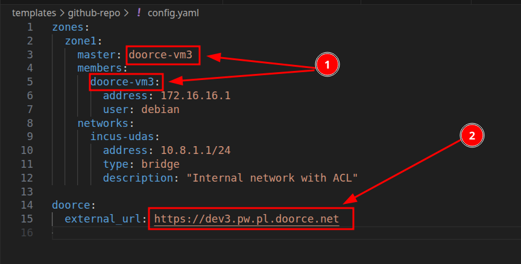
    
- In your GitHub repository settings, navigate to `Settings` -> `Secrets and variables` -> `Actions` - > `Secrets` and add the following secrets required for DoorCE:
    
    - `TRAEFIK_CERT` – contains the SSL/TLS certificate for your domain.
        
    - `TRAEFIK_KEY` – contains the SSL/TLS private key for your domain.

    - `KEYCLOAK_ADMIN_PASSWORD` – the password for the Keycloak admin account.
    

> ⚠️ **VERY IMPORTANT**:
>
> Choose a very strong, random password of at least **20 characters** to protect Keycloak, a critical part of the DoorCE service. According to [Hive Systems](https://www.hivesystems.com/blog/are-your-passwords-in-the-green?utm_source=tabletext), simple passwords can be cracked instantly, so length and randomness are the best ways to stay safe. Use a tool like the [Bitwarden](https://bitwarden.com/password-generator/) generator to create your password easily.

> 🔐 **Security Note**:
>
> In the future, if you need to change the Keycloak admin password, simply update the `KEYCLOAK_ADMIN_PASSWORD` secret in your GitHub repository settings and re-run the `DoorCE Setup` workflow to apply the new password to the Keycloak admin account.

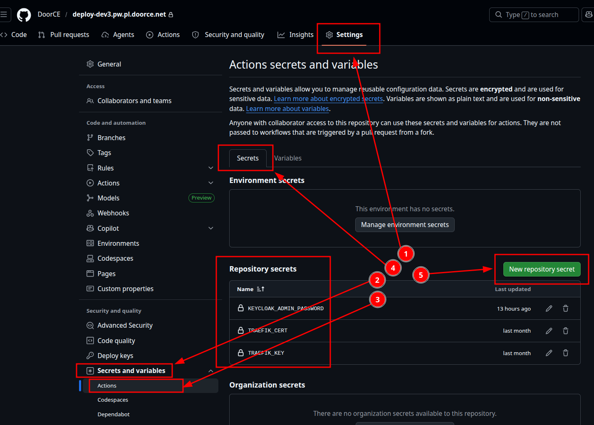

- Similarly, add the following variables in the `Variables` section (instead of secrets, these can be added as plain variables since they do not contain sensitive data):
    
    - `KEYCLOAK_ADMIN_USERNAME` – the username for the Keycloak admin account (e.g., `admin-master`).


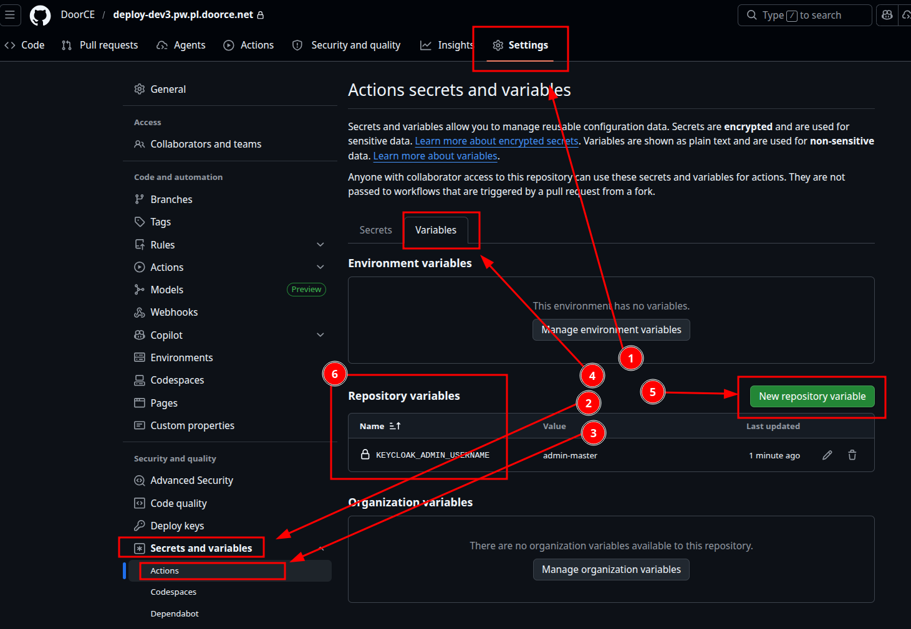


### Step 2 – Server Configuration

- Log in to the target server via SSH using your default user account (e.g. *debian*).
    
- Ensure the server meets the requirements described in the "System Requirements" section.
    
- Download the DoorCE service installer using the following link: [GitHub Runner setup](ansible/files/setup.github-runner.sh)

- Create a new self-hosted runner in the GitHub repository by using the option: `Settings` -> `Actions` -> `Runners` -> `New self-hosted runner`.


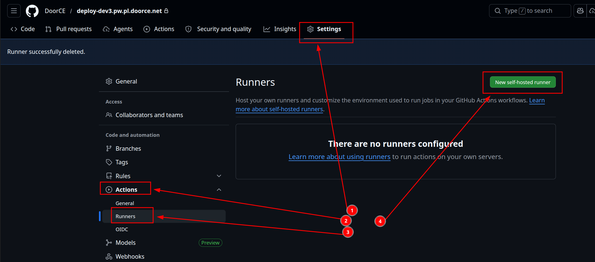


- Get the repository URL and access token from the newly created runner's parameters:


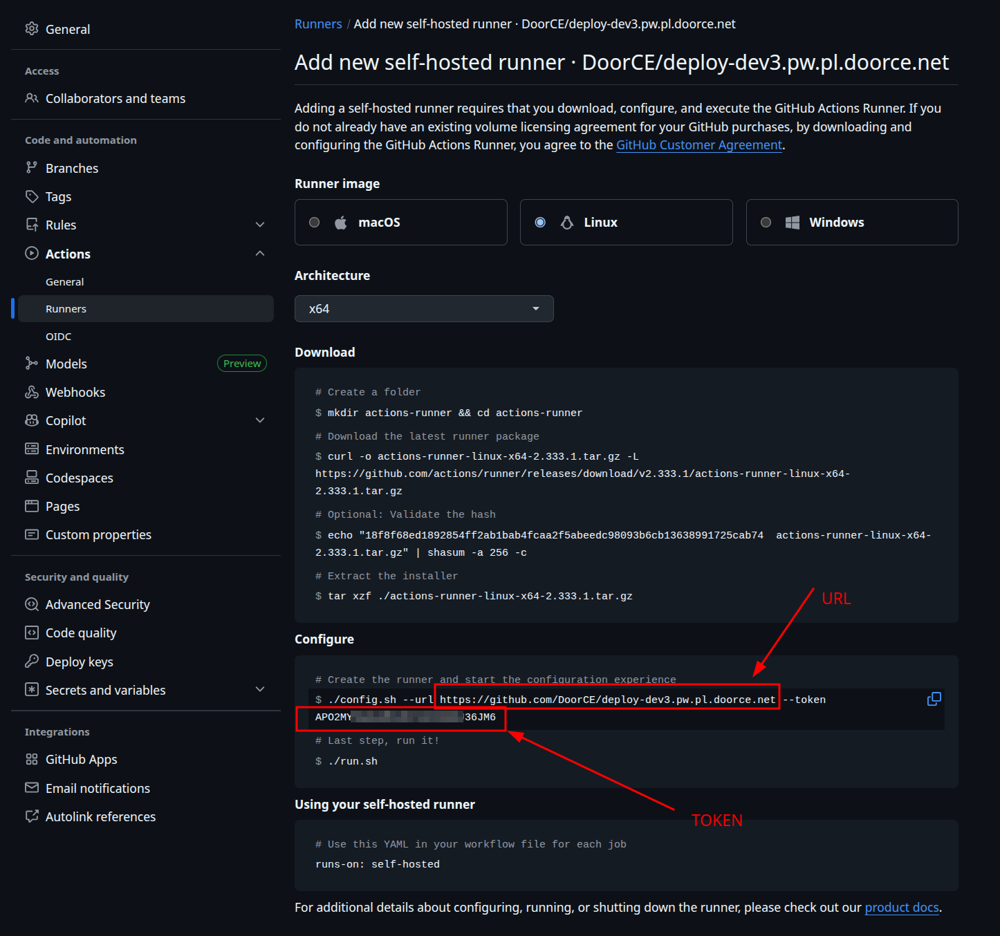


- Run the script using the following command, with the above-obtained URL and access token:
    

```bash
sudo bash setup.github-runner.sh --gh-url <github-repo-url> --gh-token <github-token>
```

Example:

```bash
sudo bash setup.github-runner.sh --gh-url https://github.com/DoorCE/deploy-dev3.pw.pl.doorce.net --gh-token XXXXXXXXXXXXXXXXXXXXXXXX
```

    
> ⚠️ **Important:**
> 
> the access token is for one-time use and is valid only for 60 minutes. It must be used within this timeframe.
    
> 🔄 **Note**:
> 
> if you need to reinstall or replace the GitHub Runner, repeat the steps above using a newly generated access token.
    
- The installer will automatically set up an [LXC](https://linuxcontainers.org/lxc/introduction/) container with the GitHub Runner. Once installation is complete, the runner should appear as "Online" (green indicator with initial status "Idle") in the GitHub panel under `Settings` -> `Actions` -> `Runners`.


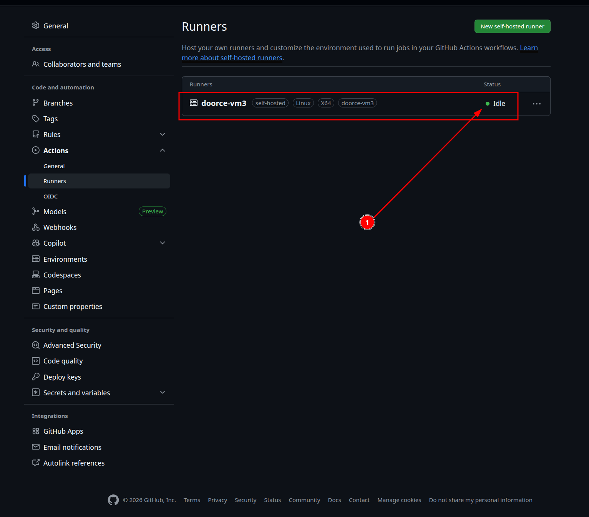    


### Step 3 – Getting access to the `DoorCEInstall` repository

> 🔑 **Note**:
> 
> After successfully installing the GitHub Runner, it must be granted access to the DoorCEInstall repository. This means that DoorCEInstall must register the public part of the SSH key generated in Step 1.
    
- Copy the contents of the file `/opt/github-runner/ssh/id_ed25519.pub` from the target server.

```bash
cat /opt/github-runner/ssh/id_ed25519.pub
```

- Send the copied contents to the DoorCE installation team through email or Teams.

> 📢 **Note**:
> 
> Since the above key is public, it can be sent using even non-secure channels. This key will be used to pull source code from the DoorCEInstall repository and perform installation operations on the server.


### Step 4 – Host Setup

- Once the GitHub Runner is online, go to your GitHub repository and navigate to the `Actions` section _(1)_.
    
- Select the workflow named `Host Setup` _(2)_.
    
- Click `Run workflow` _(3)_, select `apply` for the `Action to perform` parameter _(4)_, and click `Run workflow`. This process will configure the server and install all necessary components for the DoorCE service.


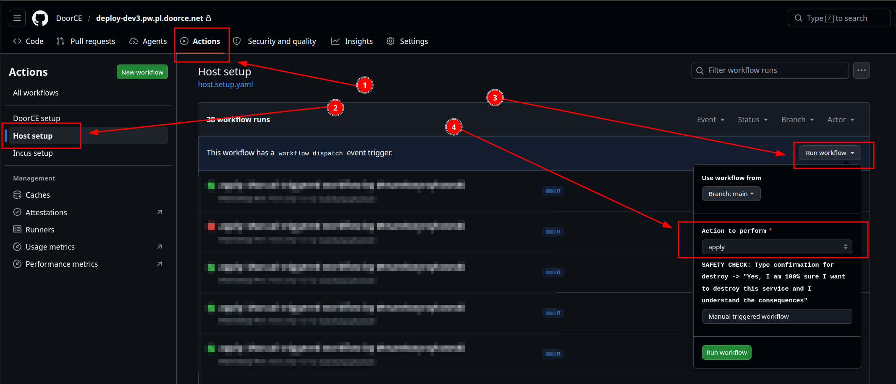


### Step 5 – Incus Installation and Configuration

- After the `Host Setup` workflow completes successfully, go to the `Actions` section and run the `Incus Setup` workflow in the same manner (selecting `apply` and clicking `Run workflow`).
    
- [Incus](https://linuxcontainers.org/incus/introduction/) is essential for DoorCE as it manages the containers where the various service components run.
    

### Step 6 – DoorCE Service Installation

- Once the `Incus Setup` workflow is finished, run the `DoorCE Setup` workflow (selecting `apply` and clicking `Run workflow`).
    
- This workflow will complete the installation by creating and configuring all necessary containers, networks, and resources. After this step, the [DoorCE](https://www.interreg-central.eu/projects/doorce/) service should be fully operational.


## 4. Additional steps

### Login into Keycloak Admin Console

- After the installation is complete, you can access the Keycloak admin console at `https://<your-domain>/keycloak/admin` using the credentials provided in the GitHub repository secrets (`KEYCLOAK_ADMIN_USERNAME` and `KEYCLOAK_ADMIN_PASSWORD`).


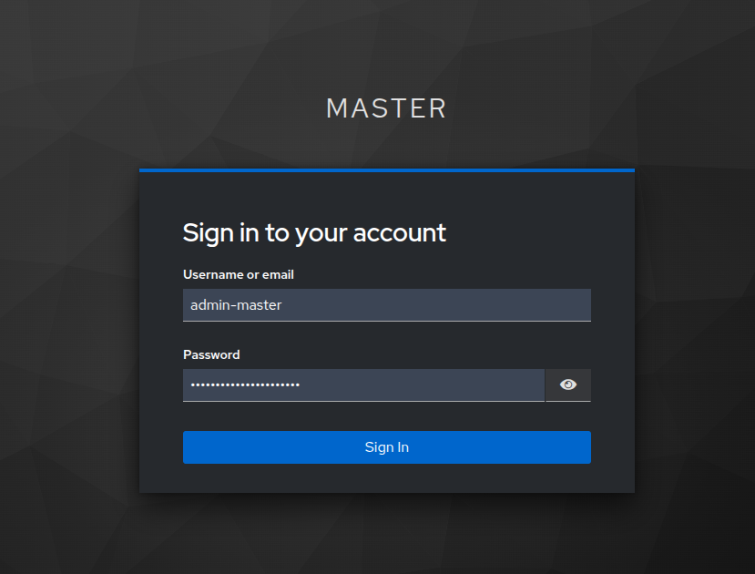


#### Adding a Log Viewer User

- After logging into the Keycloak admin console, navigate to the `Manage realms` (1) section and select the `infra` (2) realm.


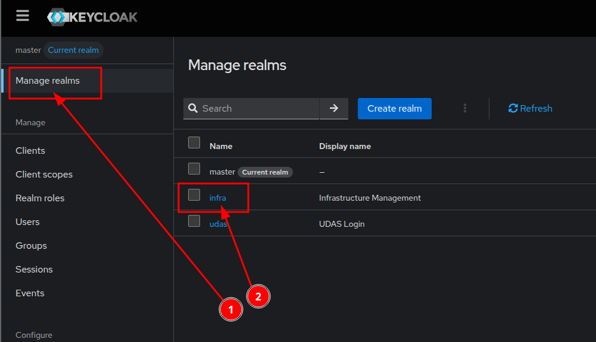


- In the `infra` realm, go to the `Users` (1) section and click on the `log-viewer` user (2) to edit its details.

> 🔑**Note**:
>
> you can also create a new user by clicking the `Add user` button. To grant this user access to the Dozzle log viewer, use the `Join Groups` button during the account creation process and add the user to the `dozzle` group.


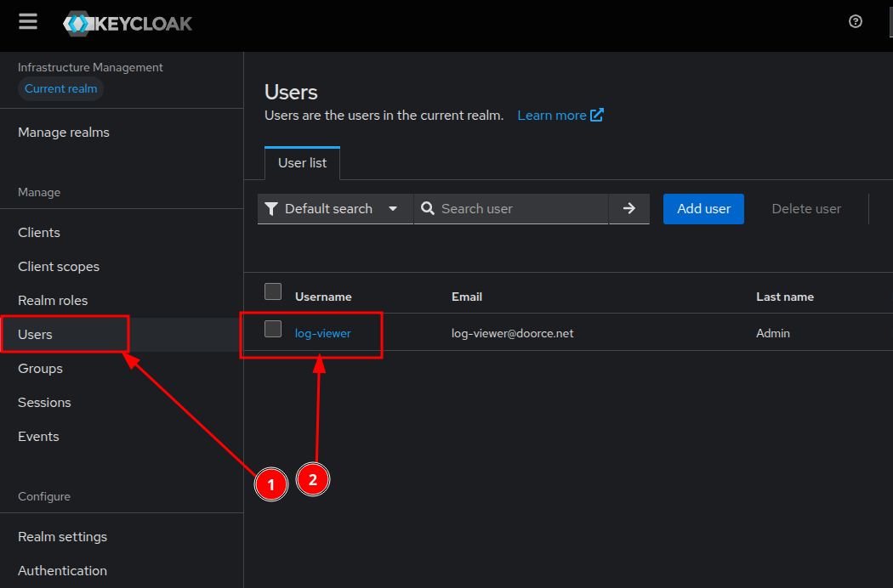


- Within the user details, navigate to the `Credentials` (1) tab and click the `Reset Password` (2) button.


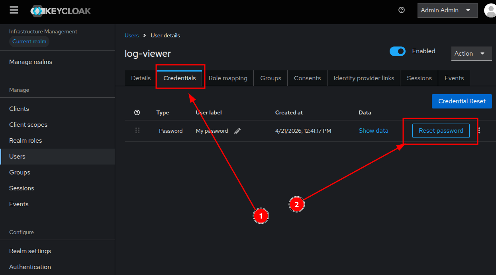


- Set a new, strong password (we recommend using the [Bitwarden](https://bitwarden.com/password-generator/) generator - minimum 20 characters). Enter it in the `Password` field (1) and repeat it in the `New password confirmation` field (2).

- **Important**: Make sure to uncheck the `Temporary` option (3). This ensures the user has permanent access and won't be forced to change the password on their first login. Finally, click the `Save` button (4) to apply the changes.


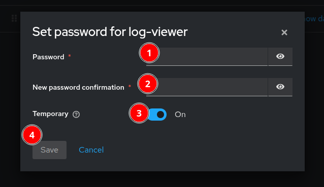


### Loging into Dozzle

- After setting up the log-viewer user in Keycloak, go to the Dozzle URL: `https://<your-domain>/dozzle`

- On the login page, enter your Keycloak log-viewer credentials.


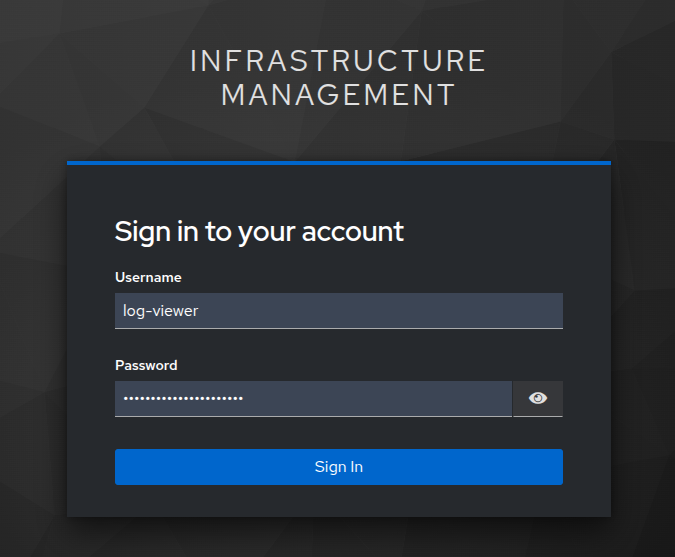


- Once logged in, you can monitor and search the real-time logs of all your running containers.

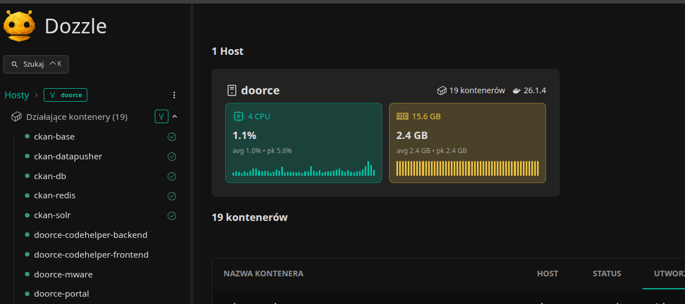


### Login into CKAN Admin Panel
- Once the installation is complete, you can access the CKAN admin panel at `https://<your-domain>/ckan` using the credentials found in the Keycloak admin console. The username is `ckan_admin`, and the password is located in the `infra` realm under the `ckan-admin-password` client secret. If needed, you can reset the password for the `ckan_admin` user within Keycloak. However, doing so requires you to run the `DoorCE Setup` workflow again to synchronize the new password with the CKAN admin account.

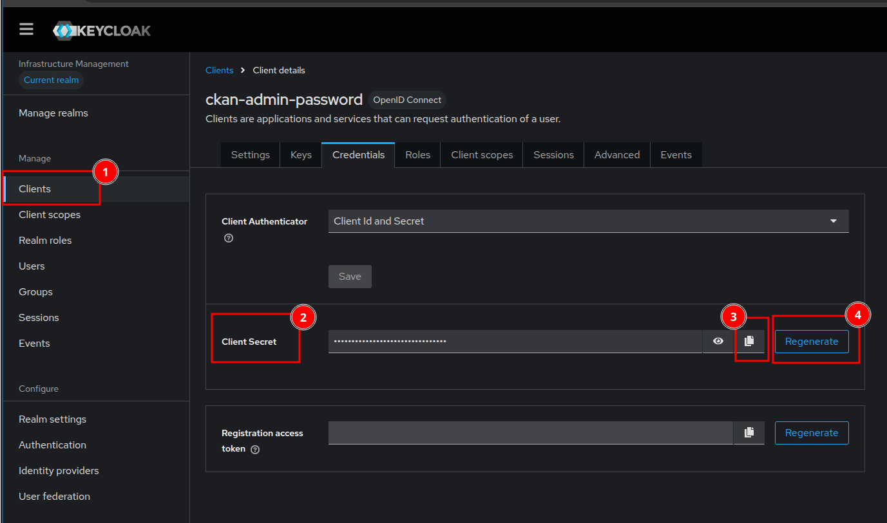

The image highlights four key elements with red markers:

- (1) "Clients" menu: Points to the section in the left navigation panel where you can access the clients for your `Infrastructure Management` realm.

- (2) "Client Secret" field: Shows the masked password within the Credentials tab for the `ckan-admin-password` client.

- (3) Copy button: Indicates the small clipboard icon next to the Client Secret. You can click this to easily copy the current password to use it for logging into the CKAN admin panel.

- (4) "Regenerate" button: Highlights the button used to reset and generate a new password. As noted in the instructions, if you use this button, you must run the `DoorCE Setup` workflow again to synchronize the new password with CKAN.